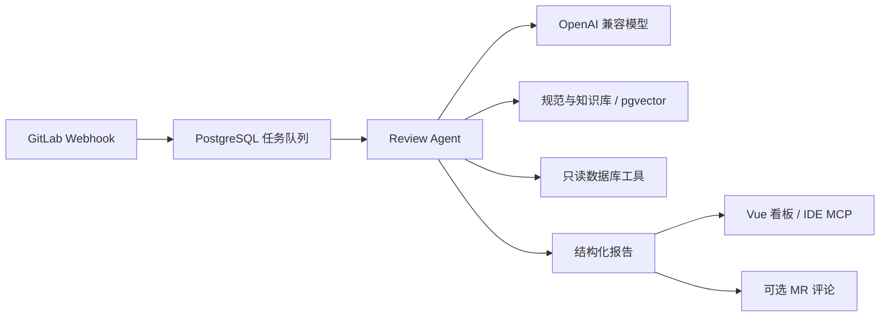

# CRbot

**把团队规范、业务知识和数据库证据带进每一次代码评审。**

[](https://github.com/lga361139387-dot/cr-bot/actions/workflows/ci.yml)
[](LICENSE)

CRbot 是面向团队自托管的 AI 代码评审工具。GitLab Push / Merge Request 触发评审，自动结合代码差异、编码规范、业务知识和只读数据库信息生成结构化报告，通过 Web 看板查看、反馈和追踪。评审异步执行，不阻塞代码推送。

## 为什么做 CRbot

通用模型能读代码，但不了解你们团队的约定和业务。CRbot 允许把这些上下文带进评审，并用证据片段、代码定位和人工反馈帮助判断结论。它适合需要私有部署、内部规范检查、业务一致性检查的团队。

- **团队上下文**：上传规范与业务文档，分块检索并引用相关条款。
- **证据辅助**：读取相关源码、匹配代码片段定位，支持事实过滤与二轮复核。
- **数据库检查**：通过配置的只读数据源查看结构和执行计划，支持 PostgreSQL、MySQL、达梦适配。
- **模型可替换**：OpenAI 兼容 Chat Completions / Embeddings 接口；对话和向量服务可独立部署。
- **反馈流程**：人工标注、评审反馈对话、重新评审，帮助团队处理误报。
- **使用可追踪**：报告、运行日志、Token 用量和任务状态集中查看。
- **IDE 接入**：提供 MCP 只读入口，查询评审记录和知识库。

> 项目处于早期阶段，尚无公开准确率基准。AI 结论需要人工判断，不代替测试和人工评审。

## 先体验：不需要 GitLab 和模型密钥

需要 Docker Desktop / Docker Compose。复制环境配置后修改管理员密码和两个随机密钥：

```sh
git clone https://github.com/lga361139387-dot/cr-bot.git
cd cr-bot
cp .env.example .env
# Windows PowerShell: Copy-Item .env.example .env
docker compose -f docker-compose.yml -f docker-compose.demo.yml up --build -d
```

打开 [本地看板](http://localhost:5173)，使用 `.env` 配置的管理员账号登录。演示模式导入 3 份明确标注 `[DEMO]` 的虚构评审，其中包含一份订单重复退款风险示例，可体验报告详情与人工标注。演示订阅默认关闭，不调用任何外部模型。

重复启动不会重复导入。关闭演示模式后已导入的报告仍保留；正式使用建议单独部署一套空数据库。演示模式的重新评审和反馈对话仍需真实模型配置。

## 正式接入

```sh
docker compose up --build -d
```

1. 登录 → **系统设置**，填写 GitLab 地址、读取仓库的 Token、Webhook 密钥。
2. 配置对话服务基础地址、模型 ID 和密钥，保存后点击连接测试。
3. 需要规范/知识库检索时，再配置向量模型。向量服务可以使用独立地址和密钥。
4. 添加项目和分支订阅，在 GitLab 设置 Webhook 指向 `https://<your-host>/api/v1/webhooks/gitlab`，勾选 Push / Merge Request，并填入相同密钥。
5. 上传编码规范与业务知识文档，确认索引成功后启用对应规范。
6. 推送代码，在评审列表查看结果。需要 MR 评论时开启回写，并给 Bot 相应权限。

GitLab 接口以 CE 11.8 的 compare / commit diff / MR changes 为兼容基线，其他版本请先在测试项目验证。MR 处理 `open`、`update`、`reopen`。

## 模型配置

| 配置 | 说明 |
| --- | --- |
| 对话基础地址 | OpenAI 兼容服务的基础路径，通常以 `/v1` 结尾；不要填写 `/chat/completions` |
| 对话模型 | 供应商或本地服务提供的模型 ID，自由填写 |
| 对话密钥 | 云服务按供应商要求填写；无鉴权本地服务可留空 |
| 工具调用 | 支持 tools 的模型可开启；不支持时关闭 |
| 温度 | 留空则不发送参数，兼容不接受 temperature 的模型；可填 0–2 |
| 向量基础地址 | 留空复用对话地址；可接入独立向量服务 |
| 向量密钥 | 同地址可复用对话密钥；不同地址须单独配置需要的密钥 |

系统设置优先于环境变量；密钥加密存储，接口只返回是否配置，留空保留已存密钥。环境变量名称见 [.env.example](.env.example)。Docker 中访问宿主机模型可使用 `http://host.docker.internal:11434/v1`；Linux 需自行设置宿主机网络映射。

**兼容边界**：当前接入的是 OpenAI 兼容协议，不直接支持各厂商原生协议。向量库固定 **1024 维**，维度不匹配会明确失败；更换向量模型后需重新索引全部相关文档。连接测试验证基础调用及向量维度，不保证模型的工具调用能力和评审准确性。

## 功能一览

| 模块 | 能力 |
| --- | --- |
| 触发与队列 | 分支匹配、Webhook 验证、事件去重、异步评审、失败重试 |
| 评审流程 | diff 过滤与分组、上下文检索、模型工具调用、证据定位、可选复核 |
| 知识管理 | 规范规则、文档预审、知识库目录、分块与混合检索 |
| 数据源 | 数据源配置、只读检查、SQL 防火墙、结构与执行计划工具 |
| 评审看板 | 报告详情、问题列表、人工反馈、重跑、日志与 Token 统计 |
| MCP | 通过 stdio bridge 为 IDE 暴露只读查询入口 |

## 架构与开发



后端 Java 17 / Spring Boot 3，前端 Vue 3 / TypeScript / Element Plus，存储 PostgreSQL + pgvector，数据库通过 Flyway 管理。当前队列使用数据库轮询；Compose 中 Redis 作为预留服务，不参与评审。

```sh
mvn -f backend/pom.xml verify
cd frontend
npm ci
npm run dev
# 生产构建：npm run build
```

运行后端前先启动 `docker compose up -d postgres`，并通过运行环境或 IDE 设置 `.env.example` 中的变量；Spring Boot 本地启动不会自动读取 `.env`。更多说明见 [架构](docs/PUBLIC_ARCHITECTURE.md)、[演示](docs/DEMO.md)、[贡献指南](CONTRIBUTING.md)。

## 当前限制与部署说明

- 当前按单团队、单后端实例使用设计；不提供租户隔离，任务恢复不支持多实例协调。
- 分组部分失败时会在报告摘要说明，整体任务仍可能显示已完成，请检查报告完整性。
- 默认配置方便本地体验。正式部署请更换所有默认密码与密钥，配置 HTTPS，仅对需要的网络开放服务；数据库使用只读账号接入。
- 不提供自动修复和准确率承诺。大变更、复杂业务和不完整知识库会影响效果与调用成本。

## 开源

采用 [MIT License](LICENSE)。欢迎通过 [Issues](https://github.com/lga361139387-dot/cr-bot/issues) 反馈问题，通过 Pull Request 贡献改进。设计参考说明见 [致谢](ACKNOWLEDGEMENTS.md)。
